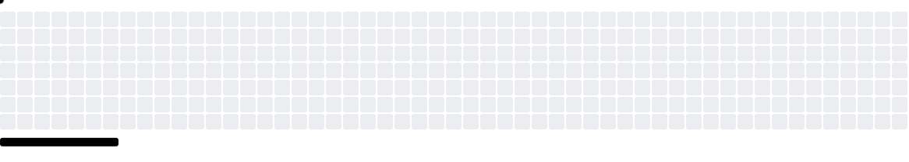

  <strong>Hi, I'm Tran Le Quoc Anh</strong>  
  <em>Small steps every day.</em> 💪

<h2 align="left">🧠 Tech Stack</h2>

### 📊 GitHub Dashboard

<table>
<tr>
<th>🔥 Contribution Streak</th>
<th>📚 Most Used Languages</th>
</tr>
<tr>
<td align="center" valign="middle">

</td>
<td align="center" valign="middle">

</td>
</tr>
</table>

### 🚀 Selected Projects

| Project | What it does | Stack |
|:--|:--|:--|
| [SchoolManagement](https://github.com/qucank2006/SchoolManagement) | School management and academic administration | Java, JavaFX, MySQL, Maven |
| [QAtech Backend](https://github.com/qucank2006/qatech_be) | Backend for an e-commerce application | Node.js, Express, MySQL |
| [QAtech Frontend](https://github.com/qucank2006/qatech_fe) | E-commerce storefront and management UI | React, Vite |
| [MovieTicketBookingApp](https://github.com/qucank2006/MovieTicketBookingApp) | Android movie ticket booking application | Java, Android SDK, Firebase |
| [DistributedFileSync](https://github.com/qucank2006/DistributedFileSync) | Distributed file synchronization and version management over LAN | Java 21, JavaFX, TCP/IP, Maven |

### 🎮 Contribution Breakout

<picture>
  <source media="(prefers-color-scheme: dark)" srcset="https://raw.githubusercontent.com/qucank2006/qucank2006/output-pacman/breakout-contribution-graph-dark.svg" />
  
</picture>

Generated automatically by GitHub Actions. The graphic will appear after the workflow runs successfully.

